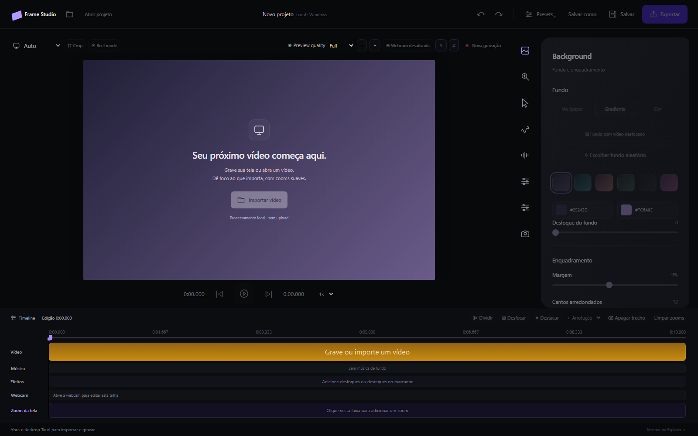

<div align="center">
  

  # Frame Studio

  **Grave, edite e transforme capturas de tela em vídeos profissionais — sem enviar seus arquivos para a nuvem.**

  [](https://tauri.app/)
  [](https://react.dev/)
  [](https://www.typescriptlang.org/)
  [](https://www.rust-lang.org/)
  [](#compatibilidade)
  [](#compatibilidade)

  [Visão geral](#visão-geral) · [Recursos](#destaques) · [Instalação](#instalação-no-windows) · [Desenvolvimento](#executando-localmente) · [Documentação](#documentação) · [Contribuição](#contribuindo)

  [](https://github.com/andreodev/screen-record/releases/download/v0.1.0/Frame-Studio-Setup.exe)
</div>

<br />



<p align="center">
  <sub>Editor desktop com preview em tempo real, inspetor visual e timeline multicamada.</sub>
</p>

## Visão geral

O **Frame Studio** é um gravador e editor de tela desktop, multiplataforma e local-first. Ele combina captura nativa, edição não destrutiva e uma experiência visual inspirada em ferramentas profissionais para produzir tutoriais, demos, apresentações e conteúdo para redes sociais.

O vídeo original permanece intacto. Cortes, zooms, cursor, webcam, aparência e efeitos são armazenados como metadados no projeto e aplicados somente na exportação.

<div align="center">
  
</div>

## Destaques

- **Processamento local:** gravações e projetos permanecem no computador.
- **Captura completa:** tela, cursor separado, webcam, microfone e áudio do sistema.
- **Zoom inteligente:** sugestões automáticas a partir de cliques, digitação e movimento do cursor, além de keyframes manuais.
- **Edição não destrutiva:** corte, divisão, velocidade entre `0,25×` e `4×`, desfazer/refazer e autosave.
- **Acabamento visual:** gradientes, wallpapers, fundo desfocado, margens, cantos e sombras.
- **Cursor cinematográfico:** temas, suavização, motion blur, efeitos de clique e ocultação por inatividade.
- **Conteúdo enriquecido:** webcam editável, anotações, máscaras, destaques, marca-d'água e legendas SRT.
- **Formatos sociais:** composição em `16:9`, `9:16`, `1:1` ou proporção original.
- **Exportação flexível:** H.264/HEVC, ProRes, até 4K e até 60 fps, conforme a plataforma.

## Fluxo de trabalho

```text
Gravar ou importar  →  Editar na timeline  →  Personalizar  →  Exportar
 tela, áudio,          cortes, zooms,         fundo, cursor,    MP4 ou MOV
 cursor e webcam       ritmo e velocidade     webcam e efeitos
```

1. Grave uma tela, janela ou área, ou importe um vídeo local.
2. Revise a timeline e ajuste cortes, velocidade e enquadramento.
3. Personalize o fundo, o cursor, a câmera, as animações e as anotações.
4. Exporte no formato, resolução, proporção e frame rate desejados.

A preparação da captura abre em uma janela compacta. Ao gravar, ela fica
oculta: use o ícone do Frame Studio na bandeja do Windows ou na barra de menus
do macOS para **pausar**, **retomar** ou **parar e abrir o editor**. Não há
contador flutuante sobre a tela. A pausa interrompe a captura dos dispositivos;
o tempo pausado não entra no vídeo final.

## Compatibilidade

| Plataforma | Captura | Edição | Exportação | Observações |
| --- | :---: | :---: | :---: | --- |
| Windows 10/11 | ✅ | ✅ | ✅ | Captura nativa, WASAPI e composição em CPU nesta versão |
| macOS 13+ | ✅ | ✅ | ✅ | ScreenCaptureKit, AVFoundation e pipeline nativo em Swift |
| Linux | — | — | — | Ainda não suportado |

> [!NOTE]
> O projeto está em desenvolvimento ativo (`0.1.0`). Recursos, formato do projeto e desempenho ainda podem mudar antes de uma versão estável.

## Instalação no Windows

**[Baixar Frame Studio v0.1.0 para Windows — instalador `.exe`](https://github.com/andreodev/screen-record/releases/download/v0.1.0/Frame-Studio-Setup.exe)**

1. Baixe o instalador para **Windows 10/11 de 64 bits**.
2. Execute `Frame-Studio-Setup.exe` e siga o assistente em português ou inglês.
3. Abra **Frame Studio** pelo menu Iniciar.

O instalador inclui FFmpeg, FFprobe, os recursos visuais e o desinstalador. Você não precisa instalar Node.js, Rust ou ferramentas de desenvolvimento para usar o aplicativo. Se o WebView2 estiver ausente, o assistente baixa o runtime da Microsoft; essa etapa requer internet.

Esta é uma versão de prévia, ainda sem assinatura digital. Políticas do Windows que exigem aplicativos assinados podem bloquear sua execução. As [notas da versão](https://github.com/andreodev/screen-record/releases/tag/v0.1.0) e o [arquivo de verificação SHA-256](https://github.com/andreodev/screen-record/releases/download/v0.1.0/SHA256SUMS.txt) acompanham o download.

Para desinstalar, abra **Configurações → Aplicativos → Frame Studio → Desinstalar**.

## Executando localmente

### Pré-requisitos comuns

- [Node.js](https://nodejs.org/) e [pnpm](https://pnpm.io/)
- [Rust](https://www.rust-lang.org/tools/install)
- Dependências de sistema exigidas pelo [Tauri 2](https://v2.tauri.app/start/prerequisites/)

Clone e instale as dependências:

```bash
git clone https://github.com/andreodev/screen-record.git
cd screen-record
pnpm install --frozen-lockfile
```

### Windows

Instale o Visual Studio Build Tools 2022 com **Desenvolvimento para desktop com C++**, o Windows SDK e o Microsoft Edge WebView2 Runtime. Em seguida:

```powershell
powershell -ExecutionPolicy Bypass -File scripts/setup-windows.ps1
npm.cmd run desktop:dev
```

O script prepara FFmpeg/FFprobe em `src-tauri/resources/ffmpeg/`. Essas ferramentas são empacotadas com a aplicação e não precisam estar no `PATH` do usuário final.

Se o Windows bloquear `pnpm.exe` com uma mensagem do Device Guard, use
`npm.cmd run desktop:dev` com as dependências já instaladas. A inicialização e o
build do Tauri usam npm e não dependem do executável global do pnpm.
Isso não altera as políticas de segurança do Windows; uma liberação desse
executável, quando necessária, deve ser feita pelo administrador da máquina.

Build local sem instalador:

```powershell
npm.cmd run desktop:build -- --debug --no-bundle
.\src-tauri\target\debug\screen-studio.exe
```

Para gerar o instalador de distribuição otimizado:

```powershell
powershell -NoProfile -ExecutionPolicy Bypass -File scripts/build-windows.ps1
```

Os arquivos prontos para publicar ficam em `artifacts/windows/`: `Frame-Studio-Setup.exe` e `SHA256SUMS.txt`. O script prepara as dependências de mídia quando necessário e gera o instalador NSIS para o usuário atual.

### macOS

Instale também o Xcode Command Line Tools, incluindo Swift:

```bash
source "$HOME/.cargo/env"
pnpm tauri dev
```

Build local do aplicativo:

```bash
pnpm tauri build --debug --bundles app
open "src-tauri/target/debug/bundle/macos/Frame Studio.app"
```

Na primeira captura, permita acesso à **Gravação de Tela e Áudio do Sistema**, câmera e microfone em *Privacidade e Segurança*.

### Apenas a interface web

```bash
pnpm dev
```

A interface abre em `http://localhost:1420`. Operações nativas, como importar, gravar e exportar, exigem o desktop Tauri.

## Projetos e privacidade

Novas gravações são armazenadas em `~/Frame Studio Projects/` dentro de pacotes portáteis `.framestudio`:

```text
Meu projeto.framestudio/
├── project.json
├── project.json.bak
├── media/
│   ├── recording.mov
│   └── recording.cursor.json
└── QuickLook/
    └── Preview.png
```

Depois do primeiro salvamento, o autosave atualiza principalmente metadados. O vídeo original não é recodificado a cada alteração e nenhuma mídia é enviada automaticamente a serviços externos.

## Arquitetura

| Camada | Tecnologias | Responsabilidade |
| --- | --- | --- |
| Interface | React 19, TypeScript, CSS | Editor, inspetor, timeline e preview |
| Desktop | Tauri 2 | Janela, IPC, diálogos, permissões e empacotamento |
| Core | Rust | Projetos, captura, preparação e exportação |
| macOS | Swift, ScreenCaptureKit, AVFoundation | Captura e composição nativas |
| Windows | Windows APIs, WASAPI, FFmpeg | Captura, áudio e codificação |

```text
src/                    # interface e lógica de edição
src-tauri/src/          # comandos Tauri e motor Rust
src-tauri/native/       # motor nativo para macOS
src-tauri/resources/    # recursos visuais empacotados
tests/                  # testes unitários, integração e benchmarks
docs/                   # decisões, planos e resultados técnicos
```

## Qualidade e testes

Validação principal da interface:

```bash
pnpm build
node --experimental-strip-types tests/zoom.test.ts
node --experimental-strip-types tests/cursor.test.ts
node --experimental-strip-types tests/cursor-response.test.ts
node --experimental-strip-types tests/animations.test.ts
node --experimental-strip-types tests/timeline.test.ts
```

Core Rust:

```bash
cargo test --manifest-path src-tauri/Cargo.toml --lib
```

No Windows, o motor pode ser validado com mídia sintética, sem acessar dispositivos:

```powershell
node tests/windows-native.test.mjs
```

Use `--capture` para uma sessão curta com dispositivos reais e `--desktop` para incluir o fluxo no WebView2 após compilar o executável debug.

## Limitações conhecidas

- A composição no Windows ainda usa CPU; exportações longas e 4K60 precisam de mais medições em hardware variado.
- HDR, orientação incomum e codecs alternativos ainda não possuem uma matriz completa de testes.
- Legendas automáticas, remoção de fundo e corte automático de palavras de preenchimento ainda não foram implementados.
- Permissões e calibração de captura podem variar entre monitores, escalas e versões do sistema operacional.

Consulte o [plano de paridade](docs/PARIDADE-SCREEN-STUDIO.md) e os [resultados de desempenho](docs/DESEMPENHO.md) para detalhes e evidências.

## Documentação

- [Estado atual da implementação](docs/IMPLEMENTACAO.md)
- [Plano completo do produto](docs/PLANO-SCREEN-STUDIO.md)
- [Cursor orgânico e zoom guiado](docs/README-SHAKE-CURSOR.md)
- [Preview flutuante da webcam](docs/README-WEBCAM-FLOATING-PREVIEW.md)
- [Biblioteca visual](docs/BIBLIOTECA-VISUAL.md)
- [Desempenho e benchmarks](docs/DESEMPENHO.md)
- [Paridade de recursos](docs/PARIDADE-SCREEN-STUDIO.md)

## Contribuindo

Contribuições, relatos de bugs e sugestões são bem-vindos. Antes de começar uma mudança grande:

1. Abra uma [issue](https://github.com/andreodev/screen-record/issues) descrevendo o problema ou proposta.
2. Crie uma branch a partir da versão mais recente do projeto.
3. Mantenha a alteração focada e inclua testes quando aplicável.
4. Execute `pnpm build` e os testes relacionados.
5. Abra um pull request com contexto, screenshots e passos de validação.

## Status e licença

Este repositório é uma demonstração em desenvolvimento. Ainda não há uma licença de código aberto definida; portanto, consulte o autor antes de reutilizar ou redistribuir o código.

---

<div align="center">
  Feito para transformar gravações comuns em apresentações que parecem cuidadosamente dirigidas.
</div>
